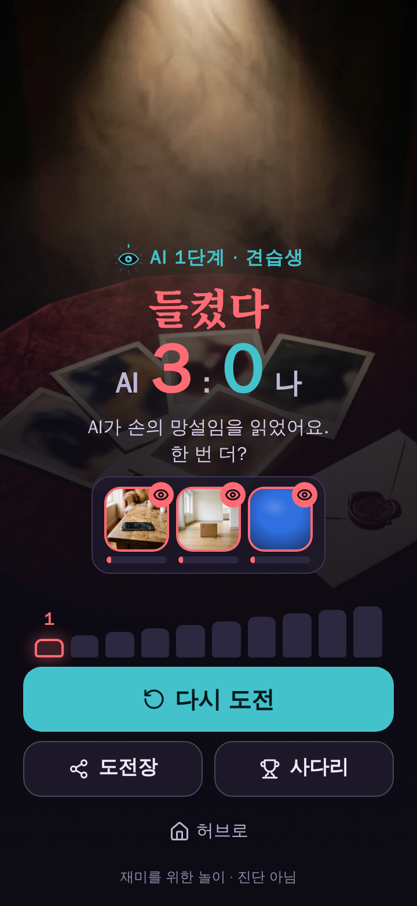

# 👁️ AI KNOWS YOU - 숨긴 사진을 찾아내는 심리 게임

> 당신이 고르기 전에, AI 는 답을 봉인해 둔다

**상태** · 보관된 프로젝트 (2026-11 웹게임 모음 「막간」에서 서비스 종료, 코드만 보관)

<br/>

## 🛠️ Tech Stack

### Frontend


### AI (자산 생성)


<br/>

## 📌 프로젝트 개요

**AI KNOWS YOU**는 사진 몇 장 중 하나를 마음속으로 숨기면, 고르는 습관을 읽어서 숨긴 사진을 찾아내는 심리 게임입니다.
AI 는 판이 시작될 때 답을 봉인해 두고, 판이 끝나면 봉인을 열어 보여 줍니다. 한 판은 3~5분.

여기서 'AI' 는 LLM 이 아니라 **브라우저 안에서 도는 통계 판정 엔진**입니다. 서버 호출 없이(비용 0원) 반응 시간만으로 판정하고, 원자료는 저장 · 전송하지 않습니다.

### 핵심 기능
- ⏱️ **반응 시간 판정** - 사진이 지나갈 때 '아니'를 누르게 하고, 숨긴 사진에서만 손이 늦어지는지 본다 (은닉 정보 검사 방식)
- 📐 **잡음 보정** - 로그 반응 시간 · MAD 로 튀는 값 자르기 · 첫 노출 / 연습 효과 / 전환 늦음을 사진 효과와 함께 맞춤
- 🔒 **봉인 → 공개** - 고르기 전에 답을 봉인, 끝나면 공개
- 🪜 **사다리** - 단계가 오를수록 AI 도 영리해지는 10단계
- 🤖 **가상 플레이어 시뮬레이션** - 봇으로 적중률 · 난이도를 미리 측정 (`sim.js`, `tools/knows_v2`)

<br/>

## 🖼️ 스크린샷



<br/>

## 📂 프로젝트 구조

```
game_hub_knows/
├── frontend/
│   ├── src/games/v2/knows/   # 판정 엔진(engine.js) · 사진 묶음(sets.js) · 사다리 · 화면
│   ├── src/platform/         # 게임 공용 껍데기
│   ├── public/knows/         # 사진 · 음악
│   └── tests/
└── tools/                    # 시뮬레이션 · 화면 캡처 · 자산 생성
```

<br/>

## ⚙️ 실행 방법 (로컬)

```bash
cd frontend
npm ci
npm run dev        # http://localhost:5174
npm test
```
